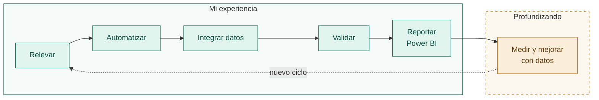

## Hola, soy Leidy Lozada 👋

**RPA Developer · Ingeniera de Sistemas · más de 6 años automatizando procesos de negocio.**

Convierto tareas repetitivas en procesos automáticos y confiables, y uso los datos que generan para medir cómo funcionan. Trabajo con clientes del sector **asegurador, financiero y administrativo**: relevo sus procesos, propongo mejoras y las llevo a producción.

- 🤖 **Automatización:** Python y UiPath. Integro datos de APIs REST, sistemas web, ERP, PDFs y Excel.
- 🧮 **Datos:** consultas en SQL Server, procesos ETL, validación de la calidad de la información y dashboards en Power BI.
- 🛠️ **Producción:** monitoreo, análisis de logs y resolución de incidentes.
- 📈 **Resultados:** reducción de hasta un **60 % en tiempos operativos** y procesos alrededor de un **40 % más estables**.
- 🌎 Montevideo, Uruguay.

---

### Experiencia

**RPA Developer** · Unimate RPA · 2021 – 2026
Automatización de procesos para clientes de los sectores asegurador, financiero y administrativo: relevamiento con clientes, integración de datos de múltiples fuentes, acceso automatizado a ERP, dashboards en Power BI y soporte en producción.

**RPA Developer Junior** · Grant Thornton Uruguay · 2019 – 2021
Automatización de procesos de alto volumen de consolidación de datos operativos, con validación de resultados y control de la integridad de la información.

**Ingeniería de Sistemas** · Universidad de los Andes, Venezuela

---

### Proyectos

#### 📈 [Analista de KPIs con SQL](https://github.com/Ladydlozada/analista-kpis-sql)
Une mis dos mundos: la integración y la validación de datos que hago en automatización, con el análisis que estoy profundizando. Es una app en Python (Streamlit + DuckDB) que toma cualquier Excel, CSV o SQLite, **valida la calidad de los datos**, propone KPIs de proceso con su SQL explicado y guarda cada análisis en un cuaderno de estudio.

- KPIs de proceso: tiempos de ciclo, cumplimiento de SLA, tasas de cancelación y rechazo, integridad referencial.
- En un caso de prueba detectó a un agente con el 73,6 % de sus tickets fuera de SLA, contra el 27,1 % general.
- Probándola encontré y corregí un error de cálculo: comparar solo el día, sin la hora, subestimaba el incumplimiento (10,4 % en vez de 27,1 %).

#### 🧾 [De facturas en PDF a Excel](https://ladydlozada.github.io/leidyrpa/)
Automatización que lee facturas de servicios en PDF, extrae sus datos y arma un Excel listo para usar: un ejemplo del tipo de proceso ETL que automatizo.

<!-- ACÁ VA LA IMAGEN "ANTES / DESPUÉS": arrastrala a este lugar en el editor de GitHub y borrá este comentario -->

---

### Herramientas

**En mi trabajo**

**Profundizando**

· KPIs de excelencia operativa

---

### Contacto

[LinkedIn](https://www.linkedin.com/in/COMPLETAR) · [Mis servicios de automatización](https://ladydlozada.github.io/leidyrpa/)
